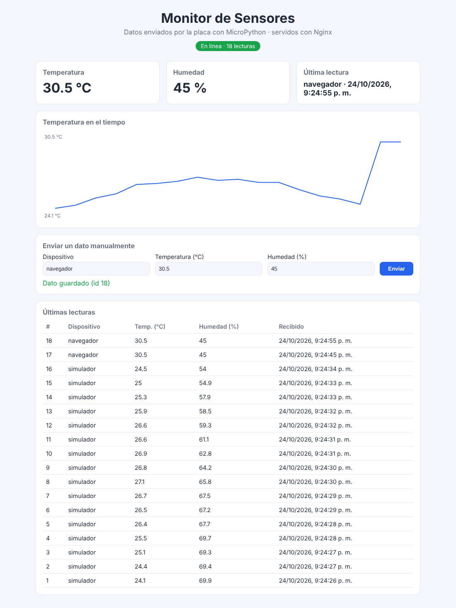

# 📡 Monitor de Sensores con MicroPython + Nginx

Una placa con **MicroPython** (ESP32, ESP8266 o Raspberry Pi Pico W) mide la temperatura
(y la humedad, si tiene un sensor DHT) y **envía los datos por WiFi** a una página web.
**Nginx** sirve la página y reenvía los datos a una pequeña **API en Python**, que los guarda
en **SQLite**. La página se actualiza sola cada 5 segundos y también permite enviar datos
a mano desde un formulario.



## ¿Cómo funciona?

```
 ┌──────────────────┐   HTTP POST /api/datos    ┌──────────────────────────────────┐
 │ Placa MicroPython│  {"dispositivo": "esp32", │              NGINX (:80)         │
 │ ESP32 / Pico W   │ ────────────────────────▶ │  /        → archivos de web/     │
 │ + sensor         │   "temperatura": 24.5,    │  /api/... → proxy a la API :5000 │
 └──────────────────┘   "humedad": 60}          └───────────────┬──────────────────┘
                                                                │
 ┌──────────────────┐   GET /api/datos (cada 5 s)    ┌──────────▼─────────┐
 │    Navegador     │ ─────────────────────────────▶ │  API Python        │
 │ (index.html+JS)  │ ◀───────────── JSON ────────── │  servidor/app.py   │──▶ SQLite
 └──────────────────┘                                └────────────────────┘
```

**¿Por qué Nginx delante?** Es el patrón que se usa en producción: Nginx es muy eficiente
sirviendo archivos estáticos y actúa como *proxy inverso*, de modo que la página y la API
quedan bajo la misma dirección (sin problemas de CORS) y la API nunca se expone directamente.

## Estructura

```
micropython-web/
├── micropython/
│   ├── config.py        # WiFi, IP del servidor, pin del sensor  ← EDITA ESTO
│   └── main.py          # programa de la placa: lee y envía cada N segundos
├── servidor/
│   ├── app.py           # API (solo biblioteca estándar de Python)
│   └── test_app.py      # pruebas automáticas
├── web/
│   ├── index.html       # la página
│   ├── estilos.css
│   └── app.js           # pide los datos, dibuja la gráfica y la tabla
├── nginx/sitio.conf     # configuración de Nginx
├── docker-compose.yml   # levanta Nginx + API con un comando
└── simulador.py         # envía datos falsos (para probar sin la placa)
```

## Paso 1 — Levantar el servidor

### Opción A: con Docker (la más fácil, sirve en Windows, Mac y Linux)

```bash
cd micropython-web
docker compose up -d
```

Abre <http://localhost>. Para detenerlo: `docker compose down`.

### Opción B: sin Docker (Linux / WSL)

```bash
sudo apt install nginx
# 1. Arranca la API (déjala corriendo en una terminal)
cd micropython-web/servidor
python3 app.py

# 2. En otra terminal, configura Nginx
sudo cp ../nginx/sitio.conf /etc/nginx/conf.d/sitio.conf
sudo nano /etc/nginx/conf.d/sitio.conf
#    - cambia  root /usr/share/nginx/html;  por la ruta de tu carpeta web/
#      (ej.: root /home/tu_usuario/Proyecto-1/micropython-web/web;)
#    - cambia  proxy_pass http://api:5000;  por  proxy_pass http://127.0.0.1:5000;
sudo rm -f /etc/nginx/sites-enabled/default   # quita la página de bienvenida
sudo nginx -t && sudo systemctl reload nginx
```

> Si ves *403 Forbidden*, Nginx no tiene permiso para leer tu carpeta: `chmod o+x` en las
> carpetas de la ruta, o copia `web/` a `/var/www/monitor` y usa esa ruta en `root`.

## Paso 2 — Probar sin la placa

```bash
python3 simulador.py                  # envía una lectura cada 3 segundos
```

Verás cómo la página se llena de datos. También puedes probar con `curl`:

```bash
curl -X POST http://localhost/api/datos \
     -H "Content-Type: application/json" \
     -d '{"dispositivo": "prueba", "temperatura": 25.3, "humedad": 58}'
```

## Paso 3 — Programar la placa

1. **Instala MicroPython** en la placa: descarga el firmware de <https://micropython.org/download/>
   y sigue las instrucciones de tu modelo (en la Pico W basta con arrastrar el `.uf2`).
2. **Busca la IP de tu computador** (el que corre Nginx): `ipconfig` en Windows,
   `ip a` en Linux. Algo como `192.168.1.100`.
3. **Edita `micropython/config.py`**: nombre y clave del WiFi, y
   `URL_SERVIDOR = "http://192.168.1.100/api/datos"` con tu IP.
4. **Copia los dos archivos a la placa** con [Thonny](https://thonny.org/) (Archivo → Guardar
   como → Dispositivo MicroPython) o con `mpremote`:
   ```bash
   pip install mpremote
   mpremote cp micropython/config.py micropython/main.py :
   mpremote reset
   ```
5. Abre la consola de Thonny (o `mpremote repl`) y verás algo como:
   ```
   WiFi conectado. IP de la placa: 192.168.1.57
   Enviado {'dispositivo': 'esp32-01', 'temperatura': 41.1} -> 201
   ```

**Sensor:** sin cablear nada se usa el sensor de temperatura **interno** del chip (marca más que
la temperatura ambiente porque el chip se calienta, pero sirve para probar). Para medidas reales
conecta un **DHT11 o DHT22** (VCC → 3V3, GND → GND, DATA → p. ej. GPIO 4) y en `config.py` pon
`PIN_DHT = 4`.

### Problemas comunes

| Síntoma | Causa probable |
|---|---|
| `No se pudo conectar al WiFi` | Clave errada, o red de 5 GHz (la ESP32 y la Pico W solo usan 2.4 GHz) |
| `Error: [Errno 113] EHOSTUNREACH` / timeout | IP equivocada en `URL_SERVIDOR`, el PC está en otra red, o el **firewall** bloquea el puerto 80 |
| Respuesta `400` | El JSON no cumple las reglas (mira el mensaje de error que devuelve la API) |
| Respuesta `502 Bad Gateway` | Nginx funciona pero la API (`app.py`) no está corriendo |

## La API

| Método | Ruta | Descripción |
|---|---|---|
| `GET` | `/api/salud` | `{"estado": "ok"}` si el servidor está vivo |
| `GET` | `/api/datos?limite=50` | Últimas lecturas, la más reciente primero (máx. 500) |
| `POST` | `/api/datos` | Guarda una lectura. Responde `201` con la lectura creada |

Reglas del JSON que se envía: `dispositivo` (texto, obligatorio, máx. 50 caracteres),
`temperatura` (número entre -50 y 150, obligatorio), `humedad` (número entre 0 y 100, opcional).

**Seguridad (opcional):** si defines la variable de entorno `API_KEY` en el servidor
(`API_KEY=mi_clave docker compose up -d`), solo se aceptarán envíos que traigan el encabezado
`X-API-Key` con ese valor. Pon la misma clave en `API_KEY` de `config.py`. (El formulario de
la página no envía la clave, así que con esta opción activada solo podrá enviar la placa.)

## Pruebas

```bash
cd servidor
python3 -m unittest -v
```

## Ideas para mejorar el trabajo

- Mostrar la humedad también en la gráfica, o usar [Chart.js](https://www.chartjs.org/).
- Una alerta visual cuando la temperatura pase un umbral.
- Encender un LED de la placa desde la página (la placa consulta una ruta `/api/ordenes`).
- Activar HTTPS en Nginx con un certificado (Let's Encrypt) si se publica en internet.
